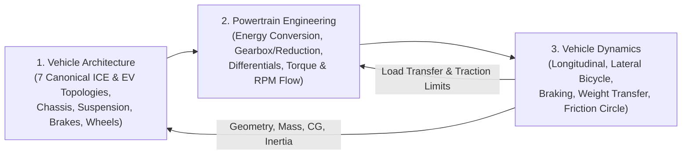

# Product Vision — KINERA

**Document ID:** `KIN-DOC-00-02`  
**Status:** COMPLETE  
**Last Updated:** 2026-11-16  

---

## 1. Purpose

This document articulates the product vision, six foundational design philosophies, pedagogical bridge between mechanics and motion, and target user groups for **KINERA — Automotive Powertrain & Vehicle Dynamics Explorer**.

## 2. Vision Statement

> **KINERA is an interactive automotive engineering laboratory that connects vehicle architecture, powertrain mechanics, and vehicle dynamics physics—allowing users to explore how mechanical and electrical layouts generate torque, distribute power to the wheels, and govern how a vehicle accelerates, corners, brakes, and transfers load.**

Rather than presenting isolated static diagrams or opaque black-box calculators, KINERA lets learners ask and empirically answer causal engineering questions:

- Why does an `ICE-FWD` transaxle vehicle exhibit different traction and weight distribution characteristics than an `ICE-RWD` longitudinal vehicle?
- How does an `ICE-AWD` center differential or torque-transfer mechanism differ mechanically and operationally from a part-time/full-time `ICE-4WD` transfer case with low-range gearing?
- How does a dual-motor `EV-DUAL-AWD` architecture achieve front/rear torque allocation electronically without a mechanical driveshaft or center differential?
- How do gear ratios, final drive ratios, and tire effective radius trade wheel torque against wheel speed?
- How do aerodynamic drag ($v^2$), rolling resistance, road gradient ($\theta$), and vehicle mass shape acceleration, gradeability, and top speed?
- How do longitudinal and lateral load transfer alter tire normal force ($F_z$), shifting available grip on the friction circle and influencing understeer/oversteer behavior?

## 3. Six Product Philosophy Principles

Every UI control, 3D interaction, mathematical model, and learning topic in KINERA must honor six core principles:

1. **Understand Before Simulating** — Every simulation control and output parameter is backed by clear component context, engineering concepts, and mathematical equations.
2. **Configuration-Based Exploration** — Users actively switch across seven canonical vehicle architectures rather than treating one drivetrain layout as universal.
3. **Engineering Accuracy** — All equations, unit conversions, efficiency accounting, and model boundaries are dimensionally verified and traceable to credible automotive engineering sources.
4. **Transparent Simulation** — Inputs, intermediate states, outputs, model assumptions, numerical tolerances, and fidelity limits are openly displayed—never hidden behind unverified claims.
5. **Interactive Engineering** — The 3D viewport is an engineering inspection instrument (isolation, exploded assembly, section cuts, power-flow highlights), not passive decorative marketing art.
6. **Comparative Understanding** — Users evaluate architectural trade-offs side-by-side under controlled, identical test conditions without declaring any single layout universally "best."

## 4. Three Interconnected Engineering Pillars

- **Pillar 1 — Vehicle Architecture:** Grounds physics in real spatial geometry and component hierarchies (`Vehicle Anatomy`).
- **Pillar 2 — Powertrain Engineering:** Explains energy flow, torque multiplication, and losses from fuel/battery to tire contact patch (`Powertrain Journey` + `Powertrain Simulation`).
- **Pillar 3 — Vehicle Dynamics:** Translates wheel-level tractive and braking forces plus steering inputs into vehicle motion, load transfer, and stability boundaries (`Vehicle Dynamics Simulation` + `Configuration Comparison`).

## 5. Target Users

| User Segment | Core Needs & Educational Goals |
| :--- | :--- |
| **Engineering Students** | Connect textbook equations ($P = T\omega$, bicycle model, load transfer) to 3D assemblies and repeatable numerical experiments |
| **Mechanical & Automotive Learners** | Inspect internal relationships between crankshaft, clutch/transaxle, transfer case, differentials, suspension, and brakes |
| **EV Technology Learners** | Compare ICE multi-gear torque multiplication against EV battery-inverter-motor single-speed reduction, regen braking, and dual-motor control |
| **Technical Educators** | Demonstrate layout trade-offs live in lectures (including offline classrooms) with controlled comparative experiments |
| **Automotive Enthusiasts** | Develop grounded engineering intuition about FWD vs. RWD vs. AWD vs. 4WD vs. EV architectures without myths |

## 6. Visual & Experiential Direction

KINERA embodies a **Premium Automotive Engineering Laboratory** aesthetic—graphite dark surfaces, titanium silver hardware, electric cyan energy/signal vectors, deep blue chassis accents, and controlled amber load/warning indicators. It intentionally avoids consumer infotainment gauges or arcade racing visuals in favor of precision CAD cutaway clarity and structured telemetry.

## 7. Cross-References

- [`PROJECT_CHARTER.md`](PROJECT_CHARTER.md)
- [`PRODUCT_REQUIREMENTS_DOCUMENT.md`](PRODUCT_REQUIREMENTS_DOCUMENT.md)
- [`../01-product-specification/USER_PERSONAS_AND_JOURNEYS.md`](../01-product-specification/USER_PERSONAS_AND_JOURNEYS.md)
- [`../08-3d-and-visualization/VISUAL_IDENTITY.md`](../08-3d-and-visualization/VISUAL_IDENTITY.md)
