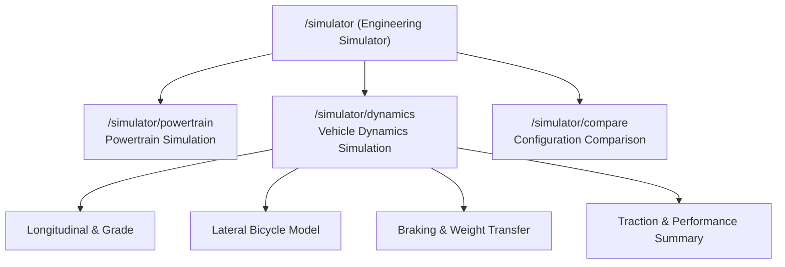

# Application Structure — KINERA

**Document ID:** `KIN-DOC-01-01`  
**Status:** COMPLETE  
**Last Updated:** 2026-11-16  

---

## 1. Purpose

Defines the information architecture, six top-level sections, global persistent controls (including the unified Configuration Selector), routing model, and responsive layout behavior for **KINERA**.

## 2. Six Approved Top-Level Application Sections

| # | Section Name | Route | Core Responsibility |
| :---: | :--- | :--- | :--- |
| 1 | **Overview** | `/` | Introduces KINERA's three pillars, showcases the active vehicle configuration in a cinematic 360° 3D stage, and offers guided entry points. |
| 2 | **Vehicle Anatomy** | `/anatomy` | Full-vehicle interactive 3D engineering cutaway, assembly hierarchy explorer, inspection modes, and component metadata/relationship inspection. |
| 3 | **Powertrain Journey** | `/journey` | Step-by-step animated energy, torque, RPM, and regenerative-braking flow across the active configuration's topology. |
| 4 | **Engineering Simulator** | `/simulator` | Unified simulation laboratory housing three connected sub-modules: **Powertrain Simulation**, **Vehicle Dynamics Simulation**, and **Configuration Comparison**. |
| 5 | **Engineering Insights** | `/insights` | ~34–37 structured conceptual engineering briefs across four domains (Powertrain Fundamentals, Vehicle Architecture, Vehicle Dynamics, EV Engineering). |
| 6 | **Technical Library** | `/library` | Ten structured, equation-backed reference modules with glossaries, engineering applications, and direct simulation scenario launchers. |

## 3. Persistent Global Shell & Configuration Selector

### 3.1 Global Navigation Shell
- **Header Bar:** KINERA wordmark (`Automotive Powertrain & Vehicle Dynamics Explorer`), six-section primary navigation, **Active Configuration Selector** pill, **Unit Display Toggle** (`SI Strict` vs `Engineering Display: km/h, kW, RPM, deg`), and **Offline Status Indicator**.
- **Shared Viewport Strategy:** Sections 1, 2, 3, and Dynamics visualizers reuse one managed WebGL `<Canvas>` lifecycle (mounted cleanly without recreating GPU contexts across routes) with mode-specific camera presets, overlays, and lighting rigs.

### 3.2 Unified Configuration Selector
Available persistently in `Vehicle Anatomy`, `Powertrain Journey`, and `Engineering Simulator` (and previewable in `Overview`), allowing instant switching among:
1. `ICE-FWD` (`vehicle.config.ice-fwd`)
2. `ICE-RWD` (`vehicle.config.ice-rwd`)
3. `ICE-AWD` (`vehicle.config.ice-awd`)
4. `ICE-4WD` (`vehicle.config.ice-4wd`)
5. `EV-FWD` (`vehicle.config.ev-fwd`)
6. `EV-RWD` (`vehicle.config.ev-rwd`)
7. `EV-DUAL-AWD` (`vehicle.config.ev-dual-awd`)

Switching configurations triggers a deterministic **Configuration Rebind Cascade**:
1. Loads the configuration manifest and validates topology.
2. Lazy-loads only delta 3D assemblies required by the new layout while retaining shared chassis/wheel assets.
3. Recomputes assembly hierarchy tree and power-flow edges.
4. Switches active simulation parameter defaults (preserving user-controlled comparison baseline flags when in Comparison mode).
5. Updates contextual Engineering Insights / Technical Library links.

## 4. Engineering Simulator Sub-Navigation

## 5. Responsive Layout Breakpoints

| Breakpoint | Viewport Width | Workspace Layout |
| :--- | :--- | :--- |
| **Desktop Laboratory** | `>= 1280px` | Left collapsible hierarchy/scenario rail (280–320px), central 3D/plot canvas, right precision telemetry & parameter inspector (340–380px) |
| **Tablet Split** | `768px – 1279px` | Top configuration strip, primary 3D/graph canvas, bottom/side tabbed drawer for parameters & telemetry |
| **Mobile Compact** | `< 768px` | Full-width 3D/chart viewport top (~45% height) + scrollable tabbed control/readout sheet bottom; adaptive low/medium 3D quality tier |

## 6. Cross-References

- [`FEATURE_SPECIFICATIONS.md`](FEATURE_SPECIFICATIONS.md)
- [`FUNCTIONAL_REQUIREMENTS.md`](FUNCTIONAL_REQUIREMENTS.md)
- [`../06-software-architecture/FRONTEND_ARCHITECTURE.md`](../06-software-architecture/FRONTEND_ARCHITECTURE.md)
- [`../08-3d-and-visualization/DESIGN_SYSTEM.md`](../08-3d-and-visualization/DESIGN_SYSTEM.md)
