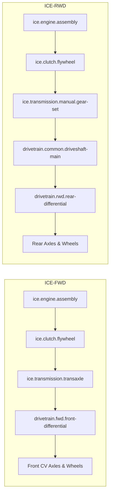
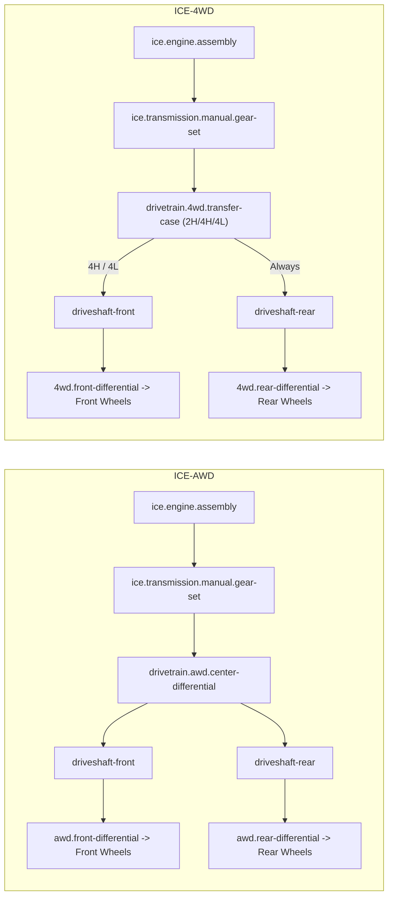
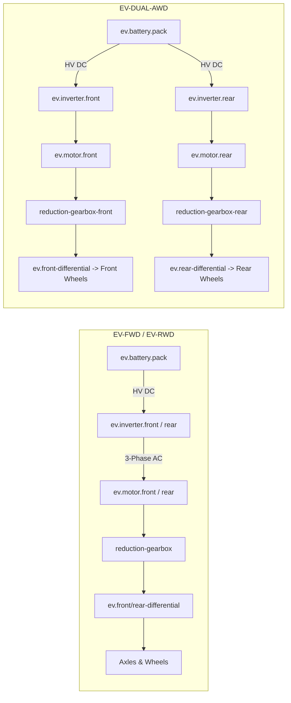

# Drivetrain Topology — KINERA

**Document ID:** `KIN-DOC-02-05`  
**Status:** COMPLETE  
**Last Updated:** 2026-11-16  

---

## 1. Purpose

Defines the formal graph representation (`DrivetrainPath` and edge connectivity rules) for all seven KINERA vehicle configurations (`KIN-VEH-016`–`KIN-VEH-018`), distinguishing mechanical shaft couplings, gear reductions, center torque splitters, electrical links, and driven wheels.

## 2. Requirements

| Req ID | Requirement |
| :--- | :--- |
| **KIN-VEH-016** | Every vehicle configuration shall define an acyclic directed propulsion topology graph from energy source (`ice.fuel.delivery-system` / `ev.battery.pack`) to active wheel contact patches (`vehicle.wheel.contact-patch`). |
| **KIN-VEH-017** | Topology validation shall verify that every driven wheel traces back to at least one prime mover through valid transmission/reduction and differential/drive-unit nodes. |
| **KIN-VEH-018** | Topology definitions shall identify which axles are driven, steered, and braked, plus which mechanical shaft speeds are coupled or decoupled. |

## 3. Topology Comparison Matrix

| Layout | Prime Movers | Transmission / Reduction | Driveshafts | Differentials / Splitters | Driven Axles |
| :--- | :--- | :--- | :--- | :--- | :--- |
| `ICE-FWD` | `ice.engine.assembly` | `ice.transmission.transaxle` | None (transaxle half-shafts only) | `drivetrain.fwd.front-differential` | Front (`vehicle.axle.front`) |
| `ICE-RWD` | `ice.engine.assembly` | `ice.transmission.manual.gear-set` | `drivetrain.common.driveshaft-main` | `drivetrain.rwd.rear-differential` | Rear (`vehicle.axle.rear`) |
| `ICE-AWD` | `ice.engine.assembly` | `ice.transmission.manual.gear-set` | `driveshaft-front`, `driveshaft-rear` | `center-differential`, `awd.front-diff`, `awd.rear-diff` | Front + Rear |
| `ICE-4WD` | `ice.engine.assembly` | `ice.transmission.manual.gear-set` + `drivetrain.4wd.transfer-case` | `driveshaft-front` (engaged in 4H/4L), `driveshaft-rear` | `4wd.front-diff`, `4wd.rear-diff` | Rear (`2H`) or Front + Rear (`4H`/`4L`) |
| `EV-FWD` | `ev.motor.front` (`pmsm`) | `ev.transmission.reduction-gearbox-front` | None | `drivetrain.ev.front-differential` | Front |
| `EV-RWD` | `ev.motor.rear` (`pmsm`) | `ev.transmission.reduction-gearbox-rear` | None | `drivetrain.ev.rear-differential` | Rear |
| `EV-DUAL-AWD` | `ev.motor.front`, `ev.motor.rear` | Dual independent `reduction-gearbox-front/rear` | None (electrical HV DC split only) | `ev.front-differential`, `ev.rear-differential` (electronic F/R split) | Front + Rear (independent) |

## 4. Topology Diagrams Across All Seven Configurations

## 5. Cross-References

- [`POWER_FLOW_TOPOLOGY.md`](POWER_FLOW_TOPOLOGY.md)
- [`COMPONENT_RELATIONSHIPS.md`](COMPONENT_RELATIONSHIPS.md)
- [`../10-quality-assurance/TOPOLOGY_VALIDATION_TESTS.md`](../10-quality-assurance/TOPOLOGY_VALIDATION_TESTS.md)
