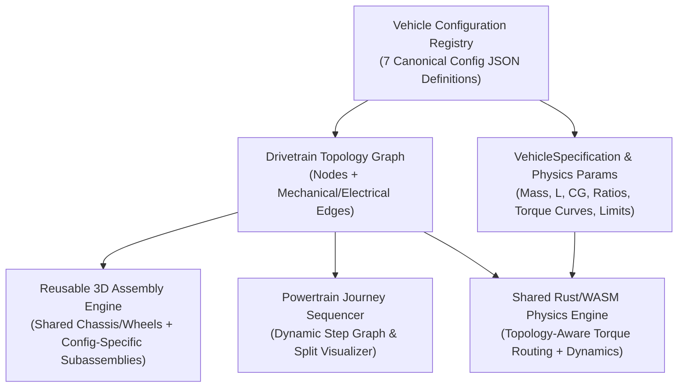

# Vehicle Architecture Overview — KINERA

**Document ID:** `KIN-DOC-02-01`  
**Status:** COMPLETE  
**Last Updated:** 2026-11-16  

---

## 1. Purpose

Defines KINERA's **configuration-driven vehicle architecture** philosophy across seven canonical ICE and EV layouts, proving how one modular registry, one 3D assembly system, and one shared physics framework serve all seven configurations without architectural duplication.

## 2. Scope

Covers architectural abstraction rules, subsystem composition, configuration switching behavior, and `KIN-VEH-001`–`KIN-VEH-008` requirements. Detailed individual layouts and component specifications reside in sibling documents under `02-vehicle-architecture/`.

## 3. Single-Engine Configuration-Driven Architecture

### Architectural Invariants (`KIN-VEH-001` – `KIN-VEH-008`)

| Req ID | Requirement |
| :--- | :--- |
| **KIN-VEH-001** | KINERA shall store vehicle configurations declaratively via canonical topology graphs and component reference IDs rather than duplicating component metadata per layout. |
| **KIN-VEH-002** | All 7 canonical configurations (`vehicle.config.ice-fwd`, `ice-rwd`, `ice-awd`, `ice-4wd`, `ev-fwd`, `ev-rwd`, `ev-dual-awd`) shall resolve through the same `VehicleConfiguration` schema (`schemas/vehicle-configuration.schema.json`). |
| **KIN-VEH-003** | Reusable vehicle subsystems (unibody/chassis, suspension, steering, braking, wheels/tires) shall share canonical definitions and parameterize attachment/mount coordinates per configuration. |
| **KIN-VEH-004** | Each configuration shall explicitly enumerate its active propulsion unit(s), transmission/reduction topology, differential/transfer mechanism(s), driven axle(s), and ordered power-flow paths. |
| **KIN-VEH-005** | Topology edges shall distinguish **mechanical shaft**, **gear mesh**, **high-voltage DC**, **multi-phase AC**, **hydraulic brake**, and **electronic control** relationships. |
| **KIN-VEH-006** | Switching configurations shall preserve shared simulation/UI framework instances while invalidating only topology-dependent cached assemblies and solver routes. |
| **KIN-VEH-007** | Every configuration shall define valid physical baseline specs (mass, wheelbase, track width, CG height, $a/b$ CG split, inertia, aero, ratios, tire radius) in SI units. |
| **KIN-VEH-008** | Architectural variations within a category (e.g., transverse vs. longitudinal AWD; part-time vs. full-time 4WD; 400V vs. 800V EV; PMSM vs. Induction) shall be explicitly documented so learners do not treat one reference implementation as the only real-world design. |

## 4. Seven Canonical Configurations Summary Matrix

| Canonical ID | Code | Propulsion | Orientation / Placement | Primary Transmission / Drive | Center Split Mechanism | Driven Wheels |
| :--- | :--- | :--- | :--- | :--- | :--- | :--- |
| `vehicle.config.ice-fwd` | `ICE-FWD` | ICE Inline-4 | Transverse Front | 6-Speed Manual Transaxle | None (Front only) | Front (2WD) |
| `vehicle.config.ice-rwd` | `ICE-RWD` | ICE Inline-4 | Longitudinal Front | 6-Speed Manual Gearbox | None (Rear only) | Rear (2WD) |
| `vehicle.config.ice-awd` | `ICE-AWD` | ICE Inline-4 | Longitudinal Front (Ref) | 6-Speed Manual + Center Diff | Center Differential / Coupling | Front + Rear |
| `vehicle.config.ice-4wd` | `ICE-4WD` | ICE Inline-4 | Longitudinal Front | 6-Speed Manual + Transfer Case | Transfer Case (`2H`/`4H`/`4L`) | Rear (`2H`) or All 4 (`4H`/`4L`) |
| `vehicle.config.ev-fwd` | `EV-FWD` | EV PMSM | Transverse Front | Single-Speed Reduction + Front Diff | None (Front only) | Front (2WD) |
| `vehicle.config.ev-rwd` | `EV-RWD` | EV PMSM | Rear Axle Mounted | Single-Speed Reduction + Rear Diff | None (Rear only) | Rear (2WD) |
| `vehicle.config.ev-dual-awd` | `EV-DUAL-AWD` | Dual EV Motors | Front + Rear Independent | Dual Independent Single-Speed Reductions | Electronic Dual-Inverter Torque Allocation | Front + Rear (Independent) |

## 5. Cross-References

- [`VEHICLE_CONFIGURATION_SPECIFICATION.md`](VEHICLE_CONFIGURATION_SPECIFICATION.md)
- [`DRIVETRAIN_TOPOLOGY.md`](DRIVETRAIN_TOPOLOGY.md)
- [`../05-simulation-engine/SIMULATION_ARCHITECTURE.md`](../05-simulation-engine/SIMULATION_ARCHITECTURE.md)
- [`../07-data-and-contracts/VEHICLE_CONFIGURATION_SCHEMA.md`](../07-data-and-contracts/VEHICLE_CONFIGURATION_SCHEMA.md)
