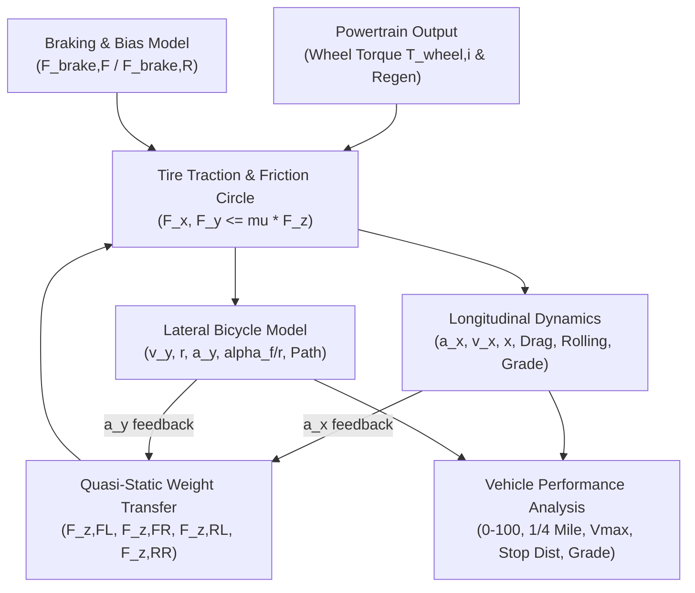

# Vehicle Dynamics Overview — KINERA

**Document ID:** `KIN-DOC-04-01`  
**Status:** COMPLETE  
**Last Updated:** 2026-11-16  

---

## 1. Purpose

Establishes the unified engineering architecture for KINERA's V1 **Vehicle Dynamics** pillar (`KIN-VDY-001`–`KIN-VDY-004`). Vehicle Dynamics is a mandatory core V1 simulator capability—not a deferred preview—linking drivetrain forces directly to longitudinal, lateral, braking, weight-transfer, and tire-friction behaviors.

## 2. Requirements

| Req ID | Requirement |
| :--- | :--- |
| **KIN-VDY-001** | KINERA V1 shall simulate five core vehicle dynamics domains: Longitudinal Dynamics, Lateral Dynamics (2-DOF Linear Bicycle Model), Braking Dynamics, Quasi-Static Weight Transfer, and Simplified Tire Traction / Friction Circle. |
| **KIN-VDY-002** | All vehicle dynamics equations shall share a single consistent ISO 8855 vehicle-fixed coordinate frame ($+X$ forward, $+Y$ left, $+Z$ up; positive yaw $r$ counterclockwise from above) and SI unit convention. |
| **KIN-VDY-003** | Vehicle dynamics modules shall couple directly to the active configuration's powertrain output ($F_{tractive}$, regen braking), mass, wheelbase $L$, track width $t$, CG position $(a, b, h)$, and yaw inertia $I_z$. |
| **KIN-VDY-004** | Every dynamics view shall display model scope, assumptions, linear validity boundaries, and explicit disclaimer that performance figures are educational simulations rather than production CAE/OEM test data. |

## 3. Coupled Vehicle Dynamics Architecture

## 4. Coordinate Frame & Sign Conventions (ISO 8855)

- **Origin:** Vehicle Center of Gravity (CG) projected onto road plane or at height $h$ above ground.
- **$+X$:** Forward longitudinal travel direction ($a_x > 0$ acceleration, $a_x < 0$ braking).
- **$+Y$:** Leftward lateral direction (positive steering $\delta > 0$ steers left; positive yaw rate $r > 0$ turns left; positive lateral acceleration $a_y > 0$ accelerates CG toward left turn center).
- **$+Z$:** Vertically upward ($g = 9.80665\text{ m/s}^2$, normal force $F_z > 0$ upward on tire).

## 5. V1 Model Fidelity Declaration

KINERA V1 provides **verified educational reduced-order models**:
- Rigid planar body (no sprung heave/roll/pitch spring-damper ODEs).
- Steady/quasi-static load transfer (no suspension kinematics/roll-center coupling).
- Linear tire stiffness for bicycle model + simplified isotropic friction circle for combined grip.
- Explicit warnings trigger automatically whenever user inputs push beyond linear model validity (e.g., $|\alpha| > 6^\circ$, $|a_y| > 0.4g$, or $v_x$ approaching critical oversteer speed).

## 6. Cross-References

- [`LONGITUDINAL_DYNAMICS.md`](LONGITUDINAL_DYNAMICS.md)
- [`LATERAL_DYNAMICS_BICYCLE_MODEL.md`](LATERAL_DYNAMICS_BICYCLE_MODEL.md)
- [`BRAKING_DYNAMICS.md`](BRAKING_DYNAMICS.md)
- [`WEIGHT_TRANSFER_MODEL.md`](WEIGHT_TRANSFER_MODEL.md)
- [`TIRE_TRACTION_AND_FRICTION_MODEL.md`](TIRE_TRACTION_AND_FRICTION_MODEL.md)
- [`VEHICLE_PERFORMANCE_ANALYSIS.md`](VEHICLE_PERFORMANCE_ANALYSIS.md)
