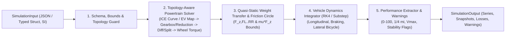

# Simulation Architecture — KINERA

**Document ID:** `KIN-DOC-05-01`  
**Status:** COMPLETE  
**Last Updated:** 2026-11-16  

---

## 1. Purpose

Defines the shared, configuration-driven simulation engine architecture uniting **Powertrain Simulation**, **Vehicle Dynamics Simulation**, and **Configuration Comparison** inside one deterministic Rust/WASM engine (`KIN-SIM-001`–`KIN-SIM-005`).

## 2. Requirements

| Req ID | Requirement |
| :--- | :--- |
| **KIN-SIM-001** | KINERA shall implement a single unified simulation engine executing all 7 canonical vehicle configurations through parameterized topology descriptors rather than configuration-specific simulation engines. |
| **KIN-SIM-002** | Powertrain Simulation, Vehicle Dynamics Simulation, and Configuration Comparison shall operate over one shared `VehicleState` and `SimulationInput`/`SimulationOutput` contract. |
| **KIN-SIM-003** | Simulation execution shall run deterministically inside a Rust/WASM module hosted in a dedicated Web Worker with zero dependency on network/backend services. |
| **KIN-SIM-004** | Every simulation output frame shall attach unit tags (`SI`), fidelity metadata, and non-blocking validity/limit warnings. |
| **KIN-SIM-005** | Topology validation shall run before solver execution; disconnected paths or unsupported topology graphs shall abort cleanly with structured error codes. |

## 3. Unified Solver Pipeline

## 4. Shared Vehicle State & Coupling

When running longitudinal acceleration or braking time-series simulations:
- At each time step $t$, current vehicle velocity $v_x(t)$ maps kinematically back to wheel speed $\omega_{wheel} = v_x / r_{eff}$ and upstream prime mover $\text{RPM}$ via active gear/reduction ratio (with smooth clutch-launch minimum RPM blend near $v_x \approx 0$ for ICE).
- Powertrain computes available wheel torques $(T_{FL}, T_{FR}, T_{RL}, T_{RR})$.
- Tire friction module caps tractive/braking forces using instantaneous normal loads $F_{z,i}(a_x, a_y)$ from the previous micro-step / fixed-point check.
- Dynamics integrates $a_x, v_x, x$ (and optionally $v_y, r, \psi, X, Y$ during cornering runs).

## 5. Cross-References

- [`SIMULATION_ENGINE_SPECIFICATION.md`](SIMULATION_ENGINE_SPECIFICATION.md)
- [`../06-software-architecture/RUST_WASM_ARCHITECTURE.md`](../06-software-architecture/RUST_WASM_ARCHITECTURE.md)
- [`../07-data-and-contracts/SIMULATION_CONTRACTS.md`](../07-data-and-contracts/SIMULATION_CONTRACTS.md)
