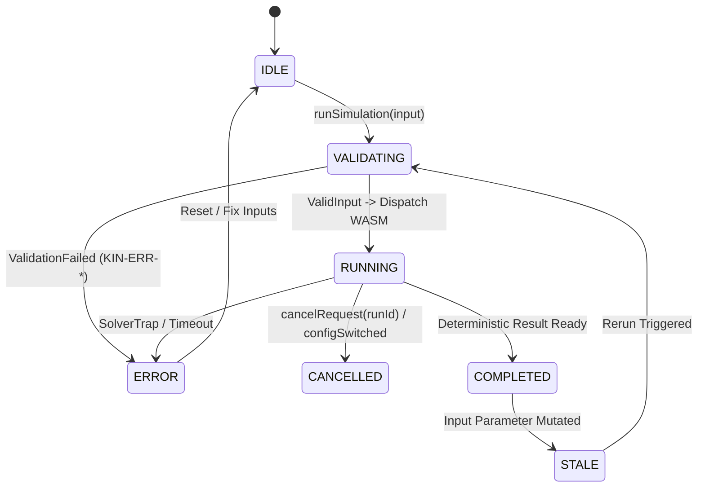

# Simulation State and Lifecycle — KINERA

**Document ID:** `KIN-DOC-05-06`  
**Status:** COMPLETE  
**Last Updated:** 2026-11-16  

---

## 1. Purpose

Defines the simulation execution lifecycle state machine, playback scrubbing, parameter mutation invalidation, and deterministic state snapshots (`KIN-SIM-023`–`KIN-SIM-024`).

## 2. Requirements

| Req ID | Requirement |
| :--- | :--- |
| **KIN-SIM-023** | Simulation runs shall follow an explicit deterministic lifecycle (`IDLE` -> `VALIDATING` -> `RUNNING` -> `COMPLETED` / `ERROR` / `CANCELLED`) managed cleanly across the UI/Worker boundary. |
| **KIN-SIM-024** | Changing any active vehicle parameter or configuration shall mark prior outputs `STALE` immediately and trigger either debounced recomputation (single-point $\le 50\text{ ms}$) or explicit `Run` trigger (long time-series). |

## 3. Lifecycle State Machine

## 4. Replay & Time-Scrubbing Behavior

- Completed time-series simulations return immutable `SimulationOutput` snapshot arrays indexed by monotonic timestamp $t_k = k \cdot \Delta t_{out}$.
- UI playback/scrubbing over completed results (including synchronizing 3D wheel spin, weight-transfer bars, and trajectory cursor) reads directly from the cached time-series buffer at $60\text{ FPS}$ without re-invoking WASM!
- Only changing physics parameters or switching configurations creates a new `requestId` and cancels any stale in-flight worker computation.

## 5. Cross-References

- [`../06-software-architecture/WORKER_COMMUNICATION.md`](../06-software-architecture/WORKER_COMMUNICATION.md)
- [`../06-software-architecture/STATE_MANAGEMENT.md`](../06-software-architecture/STATE_MANAGEMENT.md)
