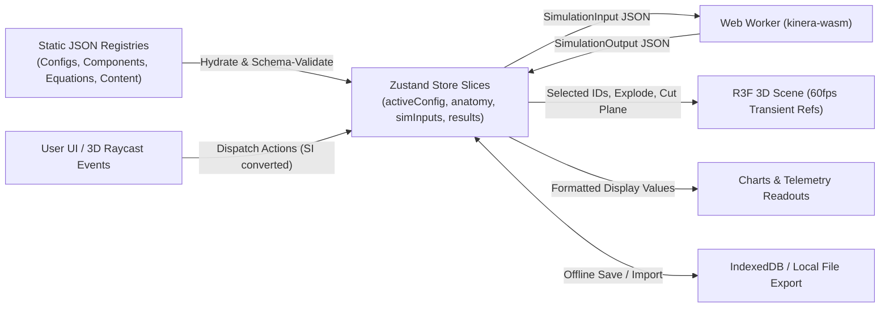

# Data Flow — KINERA

**Document ID:** `KIN-DOC-06-06`  
**Status:** COMPLETE  
**Last Updated:** 2026-11-16  

---

## 1. Purpose

Traces unidirectional data flow across static JSON registries, user interaction inputs, Zustand state slices, Web Worker/WASM solvers, 3D R3F scene bindings, and local/optional persistence.

## 2. Unidirectional Flow Diagram

## 3. Critical Data Flow Guarantees

1. **No Physics Inside React Components:** Components dispatch intent/parameters to `SimulationClient` and render `SimulationOutput`; no component manually computes $F_{drag}$ or $T_{wheel}$ in JS.
2. **60 FPS Animation Isolation:** Rapid per-frame values (wheel rotation angles, crank rotation angle, piston displacement, exploded mesh lerp offsets, section-cut clipping position) read from mutable Zustand transient references inside R3F `useFrame()` so React never triggers full VDOM re-renders at 60 Hz!
3. **Immutable Registry Lookup:** Component inspector panels and learning modules read static definitions by canonical ID (`ice.engine.crankshaft`) directly from validated in-memory registry maps (`Map<CanonicalId, Component>`).

## 4. Cross-References

- [`STATE_MANAGEMENT.md`](STATE_MANAGEMENT.md)
- [`FRONTEND_ARCHITECTURE.md`](FRONTEND_ARCHITECTURE.md)
- [`WORKER_COMMUNICATION.md`](WORKER_COMMUNICATION.md)
