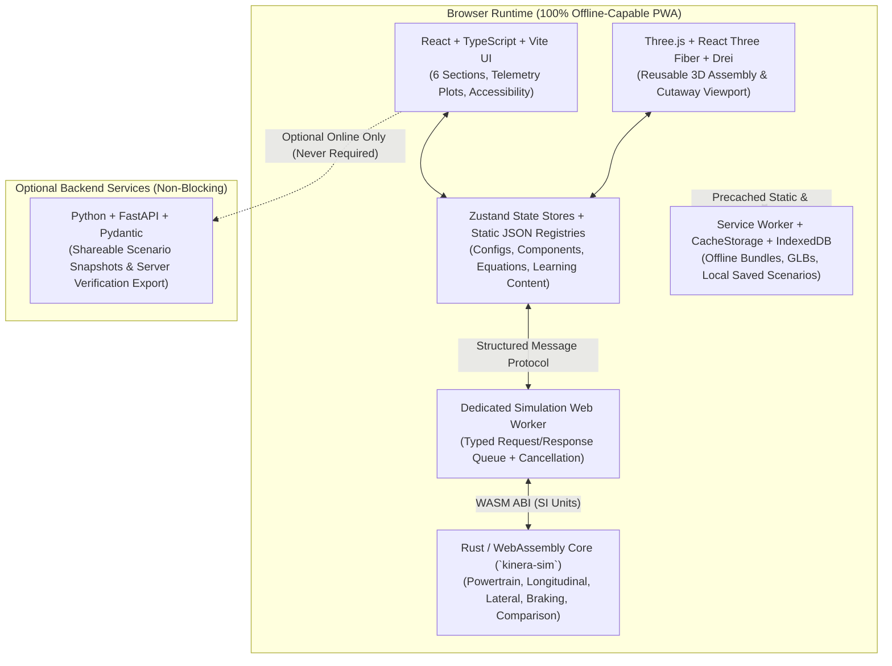

# System Architecture — KINERA

**Document ID:** `KIN-DOC-06-01`  
**Status:** COMPLETE  
**Last Updated:** 2026-11-16  

---

## 1. Purpose

Defines the end-to-end software system architecture of **KINERA**, enforcing strict separation between presentation/3D rendering, physics computation, domain registries, and optional backend services while honoring the offline-first mandate.

## 2. High-Level System Architecture

## 3. Core Architectural Invariants

1. **Single Source of Truth:** Static JSON registries (`vehicle-configs.json`, `components.json`, `equations.json`, `insights.json`, `library.json`, `animations.json`, `assets.json`) supply authoritative data to UI, 3D loader, and WASM simulation defaults.
2. **Physics Off Main Thread:** Zero ODE loops or heavy powertrain sweeps run on the JavaScript main UI thread; all run inside `sim.worker.ts` wrapping compiled Rust/WASM.
3. **Offline-First Core:** All 6 sections, all 7 configurations, core 3D assets, and WASM execution live inside browser-cached static assets.
4. **Clear Frontend/Backend Boundary:** Python/FastAPI provides strictly optional cloud features (e.g., short URL scenario sharing, educator classroom preset packs, PDF/JSON report export verification); core learning and simulation never fail if the API is unreachable (`KIN-NFR-012`).

## 4. Cross-References

- [`FRONTEND_ARCHITECTURE.md`](FRONTEND_ARCHITECTURE.md)
- [`BACKEND_ARCHITECTURE.md`](BACKEND_ARCHITECTURE.md)
- [`RUST_WASM_ARCHITECTURE.md`](RUST_WASM_ARCHITECTURE.md)
- [`OFFLINE_FIRST_ARCHITECTURE.md`](OFFLINE_FIRST_ARCHITECTURE.md)
