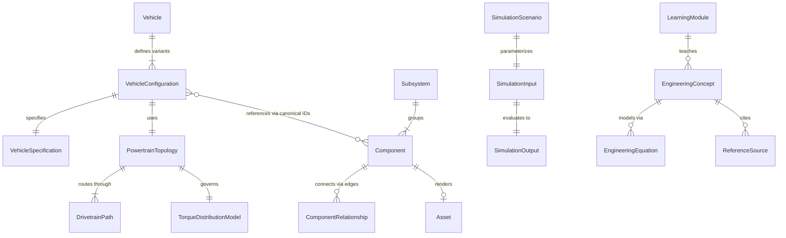

# Data Model Specification — KINERA

**Document ID:** `KIN-DOC-07-01`  
**Status:** COMPLETE  
**Last Updated:** 2026-11-16  

---

## 1. Purpose

Defines the authoritative logical and relational domain model covering all **27 required KINERA entities** (`KIN-DATA-001`–`KIN-DATA-005`), enforcing single-source-of-truth references via canonical IDs and strict SI units.

## 2. Requirements

| Req ID | Requirement |
| :--- | :--- |
| **KIN-DATA-001** | Every domain entity shall define explicit field names, TypeScript/JSON types, required/optional/nullable constraints, SI units, and foreign-key canonical ID references. |
| **KIN-DATA-002** | `VehicleConfiguration` records shall compose topology and reference IDs to `Component`, `EngineModel`, `ElectricMotorModel`, `TransmissionModel`, and `DifferentialModel` without duplicating component definitions. |
| **KIN-DATA-003** | Every persisted or transmitted entity shall embed `schemaVersion` following Semantic Versioning (`MAJOR.MINOR.PATCH`). |
| **KIN-DATA-004** | Numeric physical attributes across all 27 entities shall strictly encode SI values (`m`, `kg`, `s`, `N`, `N·m`, `rad`, `rad/s`, `W`, `J`, `V`, `A`). |
| **KIN-DATA-005** | Domain entity relationships shall form a referentially intact graph verifiable offline at build time. |

## 3. Entity Relationship Overview

## 4. Specification of All 27 Domain Entities

### 4.1 `Vehicle`
- **Purpose:** Top-level reference vehicle class descriptor (e.g., Baseline Passenger Platform vs. Body-on-Frame Utility Platform).
- **Fields:** `id` (`string`, req, canonical ID), `name` (`string`, req), `vehicleClass` (`enum: "passenger_sedan"|"crossover_awd"|"utility_4wd"`, req), `configurationIds` (`CanonicalId[]`, req, min 1), `description` (`string`, req).
- **Example:** `id: "vehicle.platform.passenger-reference"`, `configurationIds: ["vehicle.config.ice-fwd", "vehicle.config.ice-rwd", ...]`.

### 4.2 `VehicleConfiguration`
- **Purpose:** Canonical configuration node combining layout metadata, physical specification, powertrain topology, component IDs, and 3D assembly manifest reference.
- **Fields:** `id` (`CanonicalId`, req), `schemaVersion` (`string`, req), `code` (`enum: "ICE-FWD"|"ICE-RWD"|"ICE-AWD"|"ICE-4WD"|"EV-FWD"|"EV-RWD"|"EV-DUAL-AWD"`, req), `name` (`string`, req), `powertrainType` (`"ice"|"ev"`, req), `drivetrainLayout` (`"fwd"|"rwd"|"awd"|"4wd"|"dual-awd"`, req), `specification` (`VehicleSpecification`, req), `powertrain` (`Powertrain`, req), `topology` (`PowertrainTopology`, req), `componentIds` (`CanonicalId[]`, req), `supportedDiffModes` (`string[]`, req), `supportedSimulationModules` (`string[]`, req), `rootAssemblyAssetId` (`CanonicalId`, req), `architecturalVariations` (`string[]`, opt).

### 4.3 `VehicleSpecification`
- **Purpose:** Core physical dimensions, mass, inertia, and aerodynamic constants in SI units.
- **Fields:** `massKg` (`number > 0`, req), `wheelbaseM` (`number > 0`, req), `trackWidthM` (`number > 0`, req), `cgHeightM` (`number > 0`, req), `cgToFrontAxleM` (`number > 0`, req, $a$), `cgToRearAxleM` (`number > 0`, req, $b = L - a$), `yawInertiaKgM2` (`number > 0`, req, $I_z$), `dragCoefficient` (`number > 0`, req, $C_d$), `frontalAreaM2` (`number > 0`, req, $A$), `rollingResistanceCoeff` (`number >= 0`, req, $C_{rr}$), `tireModelId` (`CanonicalId`, req), `suspensionModelId` (`CanonicalId`, req), `brakeModelId` (`CanonicalId`, req).
- **Constraint:** `cgToFrontAxleM + cgToRearAxleM === wheelbaseM` ($\pm 10^{-4}\text{ m}$).

### 4.4 `Powertrain`
- **Purpose:** Aggregates prime mover(s), transmission/reduction, and differential models bound to a configuration.
- **Fields:** `id` (`CanonicalId`, req), `propulsionKind` (`"ice"|"ev_single"|"ev_dual"`, req), `engineModelId` (`CanonicalId | null`, req), `motorModelIds` (`CanonicalId[]`, req, empty for ICE), `transmissionModelId` (`CanonicalId`, req), `differentialModelIds` (`CanonicalId[]`, req), `batteryCapacityJ` (`number | null`, opt), `nominalVoltageV` (`number | null`, opt), `internalResistanceOhm` (`number | null`, opt), `inverterEfficiency` (`number | null`, opt).

### 4.5 `PowertrainTopology`
- **Purpose:** Directed acyclic propulsion/regen graph for configuration-driven simulation and 3D highlights.
- **Fields:** `id` (`CanonicalId`, req), `placement` (`"front-transverse"|"front-longitudinal"|"rear-axle"|"dual-axle"`, req), `drivenAxles` (`("front"|"rear")[]`, req), `steeredAxles` (`("front")[]`, req), `paths` (`DrivetrainPath[]`, req), `torqueDistributionModel` (`TorqueDistributionModel`, req), `hasMechanicalCenterCoupling` (`boolean`, req), `hasLowRangeTransferCase` (`boolean`, req).

### 4.6 `Subsystem`
- **Purpose:** Logical automotive system grouping in Vehicle Anatomy (e.g., `subsystem.chassis.braking`).
- **Fields:** `id` (`CanonicalId`, req), `name` (`string`, req), `systemGroup` (`enum`, req, 1 of 7 systems), `description` (`string`, req), `defaultVisibility` (`boolean`, req).

### 4.7 `Component`
- **Purpose:** Atomic inspectable hardware or conceptual component entry (`schemas/component.schema.json`).
- **Fields:** `id` (`CanonicalId`, req), `schemaVersion` (`string`, req), `name` (`string`, req), `kind` (`"physical"|"logical_subsystem"|"assembly"|"instance"`, req), `category` (`string`, req), `subsystemId` (`CanonicalId`, req), `vehicleConfigurations` (`CanonicalId[]`, req), `description` (`string`, req), `primaryFunction` (`string`, req), `operatingPrinciple` (`string`, req), `inputs` (`PortSpec[]`, req), `outputs` (`PortSpec[]`, req), `physicalProperties` (`Record<string, ValueWithUnit>`, opt), `technicalSpecifications` (`Record<string, ValueWithUnit | string>`, req), `relationships` (`ComponentRelationship[]`, req), `assetReferences` (`CanonicalId[]`, req), `animationReferences` (`CanonicalId[]`, opt), `engineeringReferences` (`CanonicalId[]`, req).

### 4.8 `ComponentRelationship`
- **Purpose:** Directed typed edge between two canonical components.
- **Fields:** `id` (`string`, req), `sourceId` (`CanonicalId`, req), `targetId` (`CanonicalId`, req), `relationshipType` (`"mechanical_drive"|"structural_mount"|"electrical_hv_dc"|"electrical_ac_phase"|"control_signal"|"hydraulic_pressure"|"tire_road_contact"`, req), `vehicleConfigurations` (`CanonicalId[]`, req), `transferredQuantity` (`string`, req), `bidirectional` (`boolean`, req).

### 4.9 `DrivetrainPath`
- **Purpose:** Ordered branch sequence from energy/torque node down to driven wheel(s).
- **Fields:** `id` (`string`, req), `axleTarget` (`"front"|"rear"`, req), `orderedComponentIds` (`CanonicalId[]`, req), `stageEfficiencies` (`number[]`, req), `cumulativeGearRatioExpr` (`string`, req).

### 4.10 `TorqueDistributionModel`
- **Purpose:** Defines center and axle torque-routing semantics for a configuration.
- **Fields:** `id` (`CanonicalId`, req), `centerMechanism` (`"none"|"center_diff"|"transfer_case"|"ev_electronic"`, req), `defaultFrontRatio` (`number` in `[0,1]`, req), `minFrontRatio` (`number`, req), `maxFrontRatio` (`number`, req), `supports2H4H4L` (`boolean`, req).

### 4.11 `EngineModel`
- **Purpose:** ICE prime mover parameters and WOT torque curve.
- **Fields:** `id` (`CanonicalId`, req), `cylinders` (`number`, req), `boreM` (`number`, req), `strokeM` (`number`, req), `displacementM3` (`number`, req), `compressionRatio` (`number`, req), `idleRpm` (`number`, req), `redlineRpm` (`number`, req), `torqueCurveNm` (`{ rpm: number; torqueNm: number }[]`, req), `frictionDragNm` (`number`, req).

### 4.12 `ElectricMotorModel`
- **Purpose:** EV traction motor envelope and efficiency map.
- **Fields:** `id` (`CanonicalId`, req), `architecture` (`"pmsm"|"induction"`, req), `peakTorqueNm` (`number`, req), `peakPowerW` (`number`, req), `baseSpeedRadS` (`number`, req), `maxSpeedRadS` (`number`, req), `nominalEfficiency` (`number`, req), `efficiencyGrid` (`number[][]`, opt), `zeroTorqueCoastDragW` (`number`, req).

### 4.13 `TransmissionModel`
- **Purpose:** Multi-speed manual, transaxle, single-speed EV reduction, or transfer case gear definitions.
- **Fields:** `id` (`CanonicalId`, req), `kind` (`"manual_gearbox"|"manual_transaxle"|"ev_single_reduction"|"conceptual_automatic"`, req), `forwardRatios` (`number[]`, req), `reverseRatio` (`number | null`, opt), `finalDriveRatio` (`number`, req, `1.0` if absorbed into `ev_single_reduction`), `stageEfficiencies` (`number[]`, req), `lowRangeRatio` (`number | null`, opt).

### 4.14 `DifferentialModel`
- **Purpose:** Axle or center differential rules (`open`, `lsd`, `locked`, `center_diff`, `ev_electronic`).
- **Fields:** `id` (`CanonicalId`, req), `mode` (`"open"|"lsd"|"locked"|"center_diff"|"ev_electronic"`, req), `torqueBiasRatio` (`number`, opt), `preloadNm` (`number`, opt), `efficiency` (`number`, req).

### 4.15 `TireModel`
- **Purpose:** Effective radius, friction preset, and linear axle cornering stiffnesses.
- **Fields:** `id` (`CanonicalId`, req), `effectiveRadiusM` (`number`, req), `nominalMu` (`number`, req), `frontAxleCorneringStiffnessNPerRad` (`number`, req), `rearAxleCorneringStiffnessNPerRad` (`number`, req), `rollingResistanceCoeff` (`number`, req).

### 4.16 `SuspensionModel`
- **Purpose:** Educational anatomy geometry parameters & visual travel scaling (no K&C solver in V1).
- **Fields:** `id` (`CanonicalId`, req), `frontType` (`string`, req), `rearType` (`string`, req), `visualMaxBounceM` (`number`, req), `visualPitchPerG` (`number`, req), `visualRollPerG` (`number`, req).

### 4.17 `BrakeModel`
- **Purpose:** Brake bias, conceptual ABS behavior, and EV regen blend limits.
- **Fields:** `id` (`CanonicalId`, req), `frontBrakeBias` (`number` in `(0,1)`, req), `maxDecelRequestMps2` (`number`, req), `absConceptualEnabled` (`boolean`, req), `absEfficiencyFactor` (`number`, req), `maxRegenPowerW` (`number | null`, opt).

### 4.18 `VehicleDynamicsModel`
- **Purpose:** Solver configuration referencing active dynamics sub-models (`vehicle.dynamics.*`) and validity limits.
- **Fields:** `id` (`CanonicalId`, req), `gravityMps2` (`number`, req, default `9.80665`), `airDensityKgM3` (`number`, req, default `1.225`), `linearSlipAngleLimitRad` (`number`, req, `0.10472`), `linearAyLimitMps2` (`number`, req, `3.92266`).

### 4.19 `SimulationScenario`
- **Purpose:** Named preset or user-saved experiment binding a `SimulationInput` with educational description.
- **Fields:** `id` (`CanonicalId`, req), `title` (`string`, req), `module` (`"powertrain"|"dynamics"|"comparison"`, req), `description` (`string`, req), `input` (`SimulationInput`, req), `relatedInsightIds` (`CanonicalId[]`, opt).

### 4.20 `SimulationInput`
- **Purpose:** Versioned input payload dispatched to `kinera-wasm` (`schemas/simulation-input.schema.json`).
- **Fields:** `schemaVersion` (`string`, req), `mode` (`"single_point_powertrain"|"time_series_dynamics"|"performance_benchmark"|"multi_config_comparison"`, req), `configurationIds` (`CanonicalId[]`, req), `parameterOverrides` (`Record<string, unknown>`, opt), `driverInputs` (`{ throttle, brakeDemand, steeringAngleRad, gearIndex, fourWdMode, diffMode, evFrontSplit }`, req), `environment` (`{ roadGradeRad, airDensityKgM3, wheelMu: [number,number,number,number], gravityMps2 }`, req), `solverConfig` (`{ dtSec, durationSec, matchedBaselineLock }`, req).

### 4.21 `SimulationOutput`
- **Purpose:** Deterministic simulation response (`schemas/simulation-output.schema.json`).
- **Fields:** `schemaVersion` (`string`, req), `engineVersion` (`string`, req), `modelFidelityTag` (`"kinera-v1-educational"`, req), `status` (`"OK"|"ERROR"`, req), `summaryMetrics` (`Record<string, ValueWithUnit>`, req), `powertrainSnapshot` (`PowertrainState | null`, opt), `timeSeries` (`TimeSeriesFrame[]`, opt), `comparisonDiffs` (`ComparisonParameterDiff[]`, opt), `warnings` (`SimulationWarning[]`, req), `simulatedEstimateDisclaimer` (`string`, req).

### 4.22 `EngineeringEquation`
- **Purpose:** Canonical equation entry shared between Simulator, Insights, and Technical Library.
- **Fields:** `id` (`CanonicalId`, req), `name` (`string`, req), `latex` (`string`, req), `classification` (`"exact_identity"|"idealized_model"|"educational_approximation"|"empirical_map"`, req), `variables` (`{ symbol, name, siUnit }[]`, req), `assumptions` (`string[]`, req), `limitations` (`string[]`, req), `referenceIds` (`CanonicalId[]`, req).

### 4.23 `EngineeringConcept`
- **Purpose:** Shared knowledge primitive cross-linked by Insights topics and Library modules.
- **Fields:** `id` (`CanonicalId`, req), `title` (`string`, req), `domain` (`"powertrain"|"architecture"|"dynamics"|"ev"`, req), `summary` (`string`, req), `equationIds` (`CanonicalId[]`, req), `componentIds` (`CanonicalId[]`, req).

### 4.24 `Asset`
- **Purpose:** 3D mesh/material bundle entry in the asset manifest.
- **Fields:** `id` (`CanonicalId`, req), `uri` (`string`, req), `format` (`"glb"`, req), `triangleCount` (`number`, req), `drawCalls` (`number`, req), `boundingBoxSiM` (`[number,number,number]`, req), `supportsSectionCut` (`boolean`, req), `lazyGroup` (`string`, req).

### 4.25 `AnimationSequence`
- **Purpose:** Declarative timeline definition (`schemas/animation-sequence.schema.json`).
- **Fields:** `id` (`CanonicalId`, req), `schemaVersion` (`string`, req), `category` (`"cinematic"|"journey"|"inspection"`, req), `vehicleConfigurations` (`CanonicalId[]`, req), `durationSec` (`number`, req), `steps` (`AnimationStep[]`, req).

### 4.26 `LearningModule`
- **Purpose:** Structured Technical Library module or Engineering Insights topic entry.
- **Fields:** `id` (`CanonicalId`, req), `kind` (`"insight_topic"|"library_module"`, req), `title` (`string`, req), `learningObjectives` (`string[]`, req), `prerequisites` (`CanonicalId[]`, req), `equationIds` (`CanonicalId[]`, req), `componentIds` (`CanonicalId[]`, req), `scenarioIds` (`CanonicalId[]`, req), `referenceIds` (`CanonicalId[]`, req).

### 4.27 `ReferenceSource`
- **Purpose:** Bibliographic technical reference entry enforcing `TECHNICAL_REFERENCE_POLICY.md`.
- **Fields:** `id` (`CanonicalId`, req), `title` (`string`, req), `authorsOrOrg` (`string`, req), `sourceType` (`"textbook"|"sae_standard"|"ieee"|"university"|"gov"|"oem_doc"`, req), `year` (`number`, req), `verificationStatus` (`"VERIFIED"|"VERIFICATION_REQUIRED"`, req), `identifierOrUrl` (`string | null`, opt).

## 5. Cross-References

- [`CANONICAL_ID_REGISTRY.md`](CANONICAL_ID_REGISTRY.md)
- [`VEHICLE_CONFIGURATION_SCHEMA.md`](VEHICLE_CONFIGURATION_SCHEMA.md)
- [`COMPONENT_SCHEMA.md`](COMPONENT_SCHEMA.md)
- [`SIMULATION_CONTRACTS.md`](SIMULATION_CONTRACTS.md)
